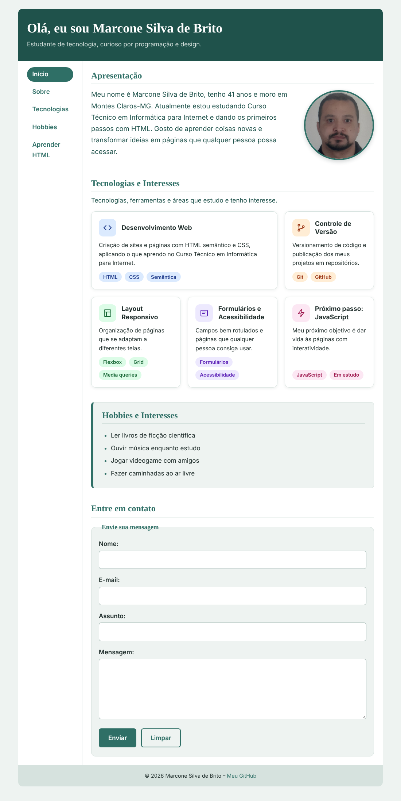

# Página Pessoal – Marcone Silva de Brito

Projeto da disciplina de Programação Web I: página pessoal com seções de apresentação, tecnologias e interesses (cartões), hobbies, navegação, rodapé e formulário de contato, estilizada com CSS externo.

## Estrutura

```
pagina-pessoal/
├── index.html
├── sobre.html
├── css/style.css
└── img/
    ├── foto.jpg
    └── captura-pagina.png
```

## Estilização com CSS

O arquivo `css/style.css` é vinculado a `index.html` e `sobre.html` pelo elemento `<link>`. Ele define cores (variáveis em `:root`), fontes, bordas, dimensões e espaçamentos, além de `:hover` nos links e botões. As classes `.intro` e `.secao-destacada` aplicam estilos específicos a elementos da página.

### Resultado no navegador



## Layout com Grid e Flexbox

- **Estrutura da página (Grid):** o `body` é uma grade de 2 colunas × 3 linhas. `header` e `footer` usam `grid-column: 1 / -1` (ocupam as duas colunas); `nav` e `main` ficam lado a lado na linha do meio com `grid-column` e `grid-row`. Em telas pequenas a grade vira 1 coluna.
- **Cartões "Tecnologias e Interesses" (Grid):** `.cartoes` usa `display: grid`, `grid-template-columns: repeat(3, minmax(0, 1fr))` e `gap`. O cartão `.cartao-destaque` ocupa 2 colunas (`grid-column: span 2`). A grade passa para 2 e 1 colunas conforme a largura da tela.
- **Interior dos cartões (Flexbox):** `.cartao` usa `display: flex` com `flex-direction: column`; `.cartao-topo` alinha ícone e título com `align-items: center`; `.tags` usa `flex-wrap` e `gap`. Os menus também usam Flexbox.

## Formulário "Entre em contato"

Campos: Nome, E-mail, Assunto e Mensagem, agrupados com `<fieldset>` e `<legend>`, com botões Enviar e Limpar.


